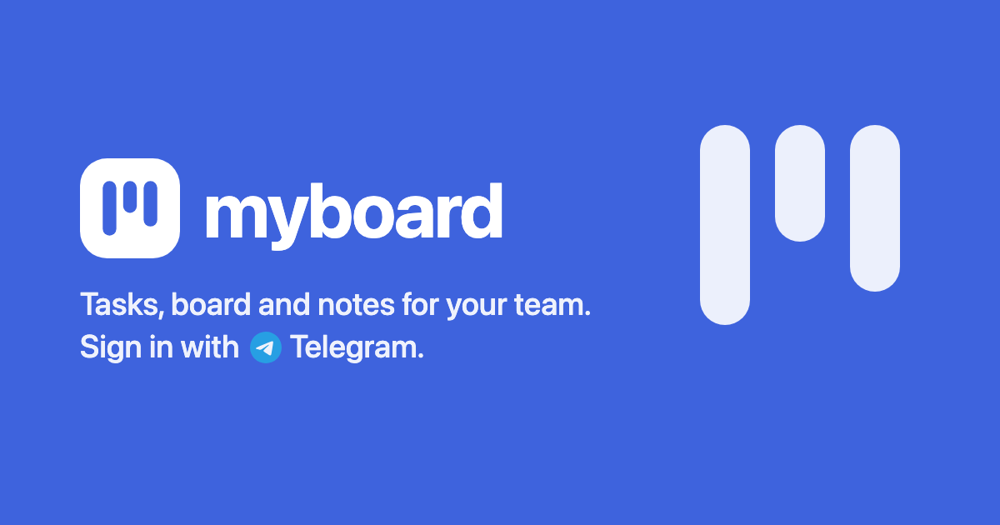

# 📋 myboard

[](https://go.dev)
[](https://pocketbase.io)
[](https://core.telegram.org/bots/telegram-login)
[](https://www.docker.com)
[](LICENSE)



Tasks, board and notes for your team. Sign in with Telegram.
Self-hosted: one Go binary on [PocketBase](https://pocketbase.io) with the web app built in.

**Features**

- **Board** — backlog, to do, in progress, done, cancelled; drag and drop, priorities, due dates, labels
- **Notes** — per project, personal or shared, in Markdown
- **Access** — people sign in with Telegram once an admin adds their Telegram ID
- **Notifications** — from the login bot: assigned to you, status of your tasks, added to a project
- **API** — personal tokens and an [`llms.txt`](web/public/llms.txt) guide for AI agents
- **Interface** — English and Russian, light and dark theme, phone layout

## Quick Start

In [@BotFather](https://t.me/BotFather) > your bot > **Login Widget** allow `https://example.com/login`
and copy the Client ID and Secret, then run with your values:

```bash
docker run -d --name myboard --restart unless-stopped \
  -p 127.0.0.1:8090:8090 \
  -v myboard-data:/myboard_data \
  -e MYBOARD_PUBLIC_URL=https://example.com \
  -e MYBOARD_ADMIN_TG_ID=123456789 \
  -e MYBOARD_TG_CLIENT_ID=0000000000 \
  -e MYBOARD_TG_CLIENT_SECRET=change-me \
  ghcr.io/nessshon/myboard
```

- **Proxy** — HTTPS in front of `127.0.0.1:8090`, passing `X-Real-IP` (nginx: `proxy_set_header X-Real-IP $remote_addr;`)
- **People** — sign in as the owner, add the others on the **Users** page

To update, pull the image and recreate the container; the data stays in the `myboard-data` volume:

```bash
docker pull ghcr.io/nessshon/myboard
docker rm -f myboard
docker run ...   # the same command as above
```

### Compose

The same with the settings kept in `.env`:

```bash
curl -fsSLO https://raw.githubusercontent.com/nessshon/myboard/master/compose.yml
curl -fsSL -o .env https://raw.githubusercontent.com/nessshon/myboard/master/.env.example
docker compose up -d   # after filling in .env
```

Update with `docker compose pull && docker compose up -d`.

## Configuration

| Variable                   | Default          | Description                                                          |
|----------------------------|------------------|----------------------------------------------------------------------|
| `MYBOARD_PUBLIC_URL`       | required         | Public address, e.g. `https://example.com`                           |
| `MYBOARD_ADMIN_TG_ID`      | required         | Owner's Telegram ID; always an admin                                 |
| `MYBOARD_TG_CLIENT_ID`     | required         | Client ID from @BotFather > your bot > Login Widget                  |
| `MYBOARD_TG_CLIENT_SECRET` | required         | Client Secret from the same place                                    |
| `MYBOARD_TG_BOT_TOKEN`     | —                | The same bot's token; turns notifications on                         |
| `MYBOARD_TRUSTED_PROXIES`  | local and Docker | Proxies allowed to send `X-Real-IP`                                  |
| `MYBOARD_HOST`             | `127.0.0.1`      | Compose only. Host address to publish on                             |
| `MYBOARD_PORT`             | `8090`           | Compose only. Host port                                              |
| `MYBOARD_DATA`             | `myboard-data`   | Compose only. Data volume, or a host folder such as `./myboard_data` |

## API

Scripts and AI agents use the same REST API as the web app.

- **Token** — each person creates one on the **Integrations** page
- **Access** — a token acts as its owner and sees exactly what they see
- **Guide** — `/llms.txt` on your instance: data, queries, recipes, errors
- **Agents** — the **Integrations** page copies a ready prompt with your address

```bash
curl -H "Authorization: Bearer mbt_..." https://example.com/api/myboard/me
```

## Development

Needs Go 1.27 and Node.js 24.

```bash
git clone https://github.com/nessshon/myboard.git && cd myboard
cp .env.example .env  # the example values are enough
make dev              # live reload at http://localhost:5173, sign in without Telegram
make check            # formatting, vet, tests and type checks
```

## License

This repository is distributed under the [MIT License](LICENSE).
